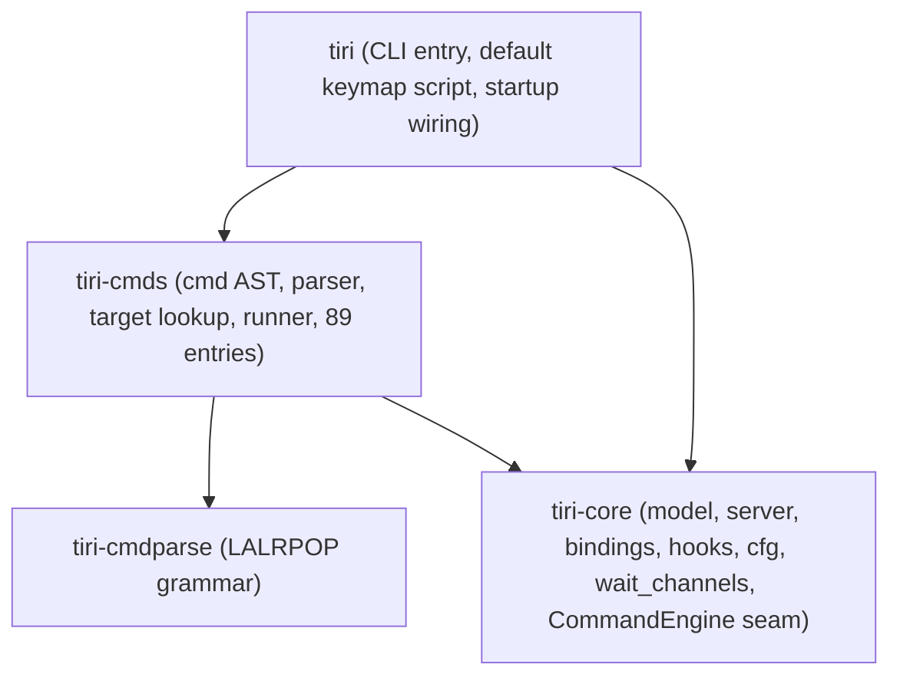
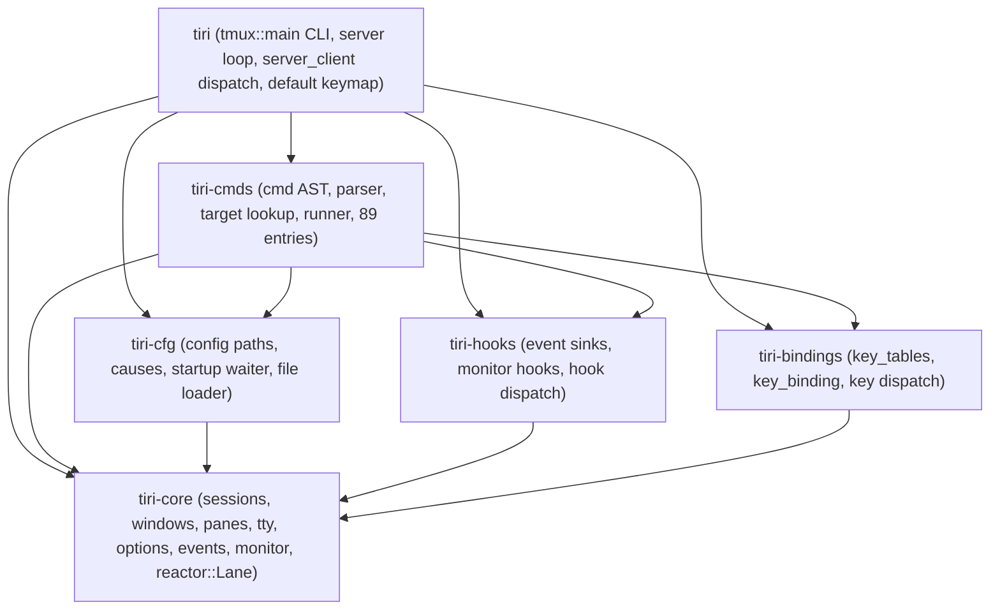
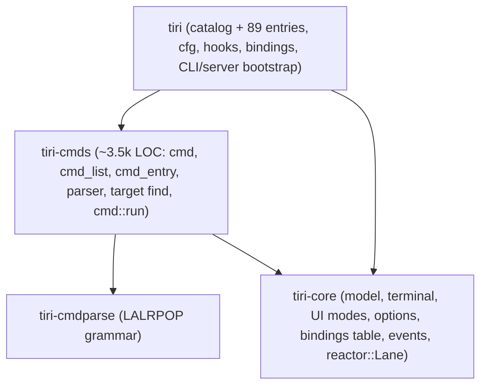

# Plan: Narrowing `tiri-cmds` and Modularizing Configs, Hooks, and Bindings

Status: design proposal.

Companion document: [plan-cmds.md](file:///home/blmarket/proj/hmux/tiri/plan-cmds.md) (converting command execution to a `Future`).

## Problem diagnosis

`tiri-cmds` was extracted from `tiri-core` so that command-system refactors do not ripple across the rest of the codebase. Today, however, [lib.rs](file:///home/blmarket/proj/hmux/tiri/tiri-cmds/src/lib.rs) installs a single 33-function-pointer `Runtime` ([actions.rs](file:///home/blmarket/proj/hmux/tiri/tiri-core/src/actions.rs#L165-L205), [runtime.rs](file:///home/blmarket/proj/hmux/tiri/tiri-cmds/src/runtime.rs#L38-L119)) that makes `tiri-cmds` responsible not only for command parsing and execution, but also for configuration state and loading, hook registration and dispatch, default key-binding initialization and key dispatch, `display-panes` argument preparation, and `wait-for` server lifecycle callbacks.

Two distinct forces caused this conflation:

1. **Command-engine consumers were bundled with the command engine.** [cfg.rs](file:///home/blmarket/proj/hmux/tiri/tiri-cmds/src/cfg.rs), [hooks.rs](file:///home/blmarket/proj/hmux/tiri/tiri-cmds/src/hooks.rs), and [key_bindings.rs](file:///home/blmarket/proj/hmux/tiri/tiri-cmds/src/key_bindings.rs) do not implement command grammar, command catalog lookup, or command execution. They *consume* compiled `ProgramRef` values and schedule them. Neither `hooks.rs` nor `key_bindings.rs` uses any private `tiri-cmds` AST or catalog type (`cmd`, `cmd_entry`, `cmd_parse_input`), and `cfg.rs` only needs file/buffer parsing plus command scheduling.
2. **Application orchestration lives inside `tiri-core`.** Because CLI parsing ([tmux.rs](file:///home/blmarket/proj/hmux/tiri/tiri-core/src/tmux.rs)), server startup and loop ([server.rs](file:///home/blmarket/proj/hmux/tiri/tiri-core/src/server.rs)), and client protocol/key dispatch ([server_client/mod.rs](file:///home/blmarket/proj/hmux/tiri/tiri-core/src/server_client/mod.rs)) sit *below* `tiri-cmds` in Cargo's dependency graph, every startup step and runtime callback had to be punched downward into `tiri_core::actions::Runtime`.

This also left three subsystems split across crate boundaries:

- **Bindings split-brain**: [tiri-core/src/bindings.rs](file:///home/blmarket/proj/hmux/tiri/tiri-core/src/bindings.rs) already owns `key_tables`, `key_table`, `key_binding` (holding `ProgramRef`), and table CRUD (`key_bindings_add`, `remove`, `reset`, `remove_table`), while [tiri-cmds/src/key_bindings.rs](file:///home/blmarket/proj/hmux/tiri/tiri-cmds/src/key_bindings.rs) holds 295 default `bind` strings and 35 lines of `key_bindings_dispatch`—even though `Program::read_only()` already exists on `Program` ([actions.rs](file:///home/blmarket/proj/hmux/tiri/tiri-core/src/actions.rs#L13), [core.rs](file:///home/blmarket/proj/hmux/tiri/tiri-cmds/src/cmd/core.rs#L264-L266)).
- **Hooks split-brain**: `tiri-core` already owns the event bus ([events.rs](file:///home/blmarket/proj/hmux/tiri/tiri-core/src/events.rs)), monitor subscriptions ([monitor/mod.rs](file:///home/blmarket/proj/hmux/tiri/tiri-core/src/monitor/mod.rs)), option storage including `options_entry::monitor_data` ([types.rs](file:///home/blmarket/proj/hmux/tiri/tiri-core/src/options/types.rs#L50)), and `EventPayloadIdentity::HookMonitor` ([shared/events.rs](file:///home/blmarket/proj/hmux/tiri/tiri-core/src/shared/events.rs#L138)), while [tiri-cmds/src/hooks.rs](file:///home/blmarket/proj/hmux/tiri/tiri-cmds/src/hooks.rs) sits in `tiri-cmds` solely to compile `@` hook strings and enqueue `ProgramRef` items.
- **Configs split-brain**: `CFG_FILES`, `CFG_QUIET`, `CFG_FINISHED`, `CFG_CLIENT`, and `CFG_CAUSES` live in [tiri-cmds/src/cfg.rs](file:///home/blmarket/proj/hmux/tiri/tiri-cmds/src/cfg.rs), forcing CLI `-f` handling ([tmux.rs](file:///home/blmarket/proj/hmux/tiri/tiri-core/src/tmux.rs#L459-L496)), `#{config_files}` ([callbacks.rs](file:///home/blmarket/proj/hmux/tiri/tiri-core/src/format/callbacks.rs#L611)), and job environment setup ([job.rs](file:///home/blmarket/proj/hmux/tiri/tiri-core/src/job.rs#L108)) to bounce through `Runtime` just to read or set server state. Meanwhile, `load_cfg_from_buffer` in `cfg.rs` has only a single caller in the entire repository: [source_file.rs](file:///home/blmarket/proj/hmux/tiri/tiri-cmds/src/entries/source_file.rs#L203).

---

## Audit of `tiri_core::actions::Runtime` (33 fields)

| Category | Fields in `Runtime` | Count | External callers & assessment |
| --- | --- | --- | --- |
| Command compilation & catalog | `parse_source`, `parse_argv`, `command_names` | 3 | **True `tiri-cmds` surface.** Compiles text/argv into `ProgramRef`; supplies command names to prompt tab-completion ([prompt.rs](file:///home/blmarket/proj/hmux/tiri/tiri-core/src/prompt.rs#L1578)). |
| Queue & execution context | `queue_new`, `queue_append`, `queue_insert`, `queue_program`, `queue_callback`, `queue_error`, `queue_drive`, `queue_running`, `queue_wait`, `queue_cancel`, `report`, `guard` | 12 | **Command runner + generic sequencer.** Under [plan-cmds.md](file:///home/blmarket/proj/hmux/tiri/plan-cmds.md), generic sequencing (`Lane`) moves to `tiri-core/src/reactor`, collapsing this entire group to `run(ProgramRef, Context)` plus one narrow ambient running-flags check for hooks. (`queue_running` currently has 0 callers in `tiri-core` only because `hooks.rs` is still in `tiri-cmds`.) |
| Dead vtable slot | `target_resolve` | 1 | **0 callers outside `tiri-cmds`.** All target resolution happens inside `tiri-cmds`. Delete immediately. |
| Mode argument leak | `has_command`, `prepare` | 2 | **1 caller:** [window_panes.rs](file:///home/blmarket/proj/hmux/tiri/tiri-core/src/window_panes.rs#L780-L834). `cmd_display_panes_entry` in [choose_tree.rs](file:///home/blmarket/proj/hmux/tiri/tiri-cmds/src/entries/choose_tree.rs#L158-L230) already holds `&cmd` and `&Rc<cmdq_item>` and can prepare the action before entering `window_panes_mode`. |
| `wait-for` lifecycle leak | `client_lost`, `flush` | 2 | Called from [server_client/mod.rs](file:///home/blmarket/proj/hmux/tiri/tiri-core/src/server_client/mod.rs#L674) and [server.rs](file:///home/blmarket/proj/hmux/tiri/tiri-core/src/server.rs#L340-L350) solely to wake/prune [wait_for.rs](file:///home/blmarket/proj/hmux/tiri/tiri-cmds/src/entries/wait_for.rs#L470-L522) channels. Channel state is a core synchronization registry (like `paste` or `bindings`), not part of the command engine. |
| Config subsystem | `config_finished`, `config_client`, `config_forget`, `config_start`, `config_files`, `config_set_files`, `config_report_missing` | 7 | **Does not belong on `tiri-cmds`.** Server startup state, error-cause buffer, and file loader. |
| Hooks subsystem | `hooks_build`, `hook_add`, `hook_is_event` | 3 | **Does not belong on `tiri-cmds`.** Event-bus subscriber over `events`, `options`, and `monitor`. |
| Bindings subsystem | `bindings_init`, `binding_dispatch` | 2 | **Does not belong on `tiri-cmds`.** Default keymap bootstrap and `ProgramRef` key dispatch. |

Out of 33 fields, **19 do not belong to command execution**, and 11 more are queue plumbing slated to collapse into `Lane` + `cmd::run`.

---

## Reverse-dependency constraint to keep in mind

Any alternative design must account for **both directions** of calls:

1. **Server / UI -> Subsystems**: `server`, `server_client`, `tmux::main`, `window_customize`, `format`, and `job` read config state, initialize/query hooks, and initialize/dispatch key bindings.
2. **Command entries -> Subsystems**: Command entries in `tiri-cmds/src/entries/` mutate those subsystems:
   - `bind-key`, `unbind-key`, `list-keys`, `switch-client` call `tiri_core::bindings::*`; `send-keys` calls `key_bindings_dispatch`.
   - `set-hook` ([set_option.rs](file:///home/blmarket/proj/hmux/tiri/tiri-cmds/src/entries/set_option.rs)) calls `hooks_add_event`, `hooks_run`, `hooks_monitor_add`, and `hooks_monitor_remove`; `show-hooks` ([show_options.rs](file:///home/blmarket/proj/hmux/tiri/tiri-cmds/src/entries/show_options.rs)) calls `hooks_is_event`; `wait-for` calls `hooks_valid_event_name`.
   - `source-file` parses buffers and prints `cfg` causes; `new-session` and `attach-session` call `cfg_show_causes`; `cmdq_error` records startup errors into `cfg_add_cause` while `!cfg_finished()`.

Because command entries manipulate bindings, hooks, and config state, **either** those subsystems sit *below* `tiri-cmds` (in `tiri-core` or intermediate domain crates), **or** the command entries themselves sit *above* `tiri-cmds` alongside those subsystems.

> [!WARNING]
> **Anti-pattern to reject: splitting `Runtime` into four global vtables (`CommandRuntime`, `ConfigRuntime`, `HooksRuntime`, `BindingsRuntime`) in `tiri-core`.**
> Replacing one `OnceLock<&'static Runtime>` with four separate `OnceLock` registration traits in `tiri-core` keeps orchestration inverted, adds pure boilerplate indirection (violating AGENTS.md's minimal-abstraction rule), and still forces `tiri-core` to define vtables for its own CLI flags and key tables.

---

## Alternative designs

### Alternative 1: Narrow `CommandEngine` + Move `cfg`, `hooks`, and `bindings` into Core Domain Modules (Pragmatic / Lowest Churn)

Keep the existing crate topology (`tiri-core <- tiri-cmds <- tiri`), strip `tiri-cmds` down to **pure command compilation, catalog, and execution**, and move the displaced domain subsystems to where their underlying state already lives:



- **Bindings**: Move `key_bindings_dispatch` and default-table snapshotting into [tiri-core/src/bindings.rs](file:///home/blmarket/proj/hmux/tiri/tiri-core/src/bindings.rs) (using `bd.cmdlist().read_only()`). Move the 295 default `bind ...` script strings out of `tiri-cmds` into top-level `tiri` startup (or a declarative startup slice passed from `tiri`), so neither `tiri-cmds` nor `tiri-core` hardcodes user-level default keybindings if desired, or run them from `tiri::initialize()`.
- **Configs**: Move `CFG_*` state, `cfg_add_cause`, `cfg_show_causes`, `cfg_print_causes`, and `start_cfg` / `load_cfg` into `tiri_core::cfg` (using `CommandEngine` to parse multi-group file bytes). Inline `load_cfg_from_buffer` into its sole caller, [source_file.rs](file:///home/blmarket/proj/hmux/tiri/tiri-cmds/src/entries/source_file.rs).
- **Hooks**: Move `hooks.rs` into `tiri_core::hooks` alongside `events.rs`, `monitor/`, and `options/` (where `control_notify.rs` already lives as a sibling event-bus consumer). `set-hook`, `show-hooks`, `wait-for`, `window_customize`, and `server` all call `tiri_core::hooks` directly.
- **`wait-for` & `display-panes`**: Move `wait_channels` / `wait_event_items` state into `tiri-core` (leaving flag parsing and command execution in `entries/wait_for.rs`), and prepare `display-panes` template commands inside `entries/choose_tree.rs`.
- **Resulting `CommandEngine` seam in `tiri-core`**:
  - Pre-Future refactor: only command compilation (`parse`, `parse_argv`, `command_names`) and queue execution primitives (14 functions total; zero config/hook/binding/wait callbacks).
  - Post-[plan-cmds.md](file:///home/blmarket/proj/hmux/tiri/plan-cmds.md): **4 operations** (`parse`, `parse_argv`, `command_names`, `run`, plus narrow ambient running-flags query for `NOHOOKS`).

**Trade-offs**:
- **Pros**: Zero new crates; eliminates all split-brain state; removes all 19 non-engine callbacks; preserves static calls from `entries/*` into `bindings`, `hooks`, and `cfg`; completely orthogonal to [plan-cmds.md](file:///home/blmarket/proj/hmux/tiri/plan-cmds.md).
- **Cons**: `tiri-core` grows by ~1,100 lines (`hooks.rs` + `cfg.rs` + `wait_channels`) and continues to hold both low-level terminal/session state and active server/hook/config policy.

---

### Alternative 2: Dedicated Domain Crates (`tiri-bindings`, `tiri-hooks`, `tiri-cfg`) + Top-Level Host Extraction (`tiri`)

If the goal is not only to keep `tiri-cmds` pure, but *also* to keep `tiri-core` focused on the core session/window/pane/terminal model rather than accumulating `cfg` and `hooks`, extract the features into focused crates **and** lift server/CLI orchestration up into `tiri`:



Why lifting `server` / `tmux::main` is required here: if `server.rs`, `server_client`, and `tmux.rs` remained inside `tiri-core`, `tiri-core` could not call `tiri-cfg`, `tiri-hooks`, or `tiri-bindings` without re-introducing callback vtables for each crate. Moving the orchestrator up to `tiri` turns [src/lib.rs](file:///home/blmarket/proj/hmux/tiri/src/lib.rs) from a 30-line re-export shim into the actual application host.

**Seams that must be resolved cleanly in Alternative 2**:
1. **`ClientRef` split**: Many command entries in `tiri-cmds` (`attach-session`, `detach-client`, `switch-client`, `refresh-client`, `kill-server`, `server-access`) mutate client and server state. Client *model state* and registry remain in `tiri-core`, while imsg protocol dispatch, key-event routing, and the main event loop move to `tiri`.
2. **`window_customize` & passive metadata**: `choose-tree` / `customize-mode` entries in `tiri-cmds` reference `window_customize_mode`. Either UI modes move above `tiri-bindings`/`tiri-hooks` (below `tiri-cmds`), or passive `@` hook-event membership (a `HashSet<CString>` on `events`) and passive `config_files` / `config_finished` flags stay in `tiri-core` (needed by `#{config_files}` in `format` and `job.rs`).
3. **`CommandEngine` seam**: `tiri-core` (`OPTIONS_TABLE_COMMAND` parsing and UI modes) plus `tiri-cfg`/`tiri-hooks`/`tiri-bindings` still compile/schedule `ProgramRef` via the small 4-method `CommandEngine` installed by `tiri` at startup.

**Trade-offs**:
- **Pros**: Every subsystem (`core`, `bindings`, `hooks`, `cfg`, `cmds`, `tiri` server) has a crisp, single-purpose crate boundary and acyclic dependency direction; `tiri` owns startup sequence explicitly (`bindings::init` -> `hooks::init` -> `cmds::install` -> `server::start`).
- **Cons**: Splitting `server.rs` and `server_client/` (~4,500 LOC) between `tiri-core` client model and `tiri` server loop is non-trivial refactoring work, and adds 3 workspace crates for relatively small modules (~200–575 LOC each).

---

### Alternative 3: Pure Engine `tiri-cmds` (No Entries) + Catalog & Features in `tiri`

Notice that `tiri-cmds` currently mixes **two** layers of very different size and volatility:
- **The Command Engine (~3,500 LOC)**: `cmd`, `cmd_list`, `cmd_entry`, `parse`, `find`, `arguments/commands`, and `queue` / `run`. This is the *entire* scope of [plan-cmds.md](file:///home/blmarket/proj/hmux/tiri/plan-cmds.md).
- **The 89 Concrete Commands (~18,000 LOC)**: `entries/*.rs` and `catalog.rs`, which reach into every corner of tmux (sessions, panes, layouts, modes, bindings, hooks, config files, wait channels, server ACLs).

Alternative 3 narrows `tiri-cmds` even further—to **only the command language and execution engine**—and places `entries/`, `catalog`, `cfg`, `hooks`, and `bindings` together in `tiri` (or feature modules inside `tiri`):



How catalog lookup works without a dynamic registration API (preserving [plan-cmds.md](file:///home/blmarket/proj/hmux/tiri/plan-cmds.md)'s rule against dynamic command registration):
- `tiri-cmds` defines `pub struct cmd_entry` and accepts a single static slice `&'static [&'static cmd_entry]` when constructing/installing the `CommandEngine` (or passes the slice to `cmd::parse`). There is still only one static table and one API.

**Trade-offs**:
- **Pros**:
  - `tiri-cmds` becomes tiny (~3.5k LOC), fast to compile and test in isolation, and 100% faithful to "command parsing and execution features only".
  - `cfg`, `hooks`, `bindings`, and `wait-for` live right next to `source-file`, `set-hook`/`show-hooks`, `bind-key`/`unbind-key`, and `wait-for` in `tiri`—eliminating reverse-dependency friction without bloating `tiri-core`!
- **Cons**:
  - Moving `entries/*.rs` out of `tiri-cmds` requires `cmd`, `Invocation`, target-lookup flags, and argument helpers in `tiri-cmds` to be `pub` across the `tiri-cmds` -> `tiri` crate boundary rather than `pub(crate)`.
  - Best sequenced *after* (or alongside Phase 2 of) [plan-cmds.md](file:///home/blmarket/proj/hmux/tiri/plan-cmds.md), once the `cmd_exec_fn` / `Invocation` signature stabilizes, so 89 entry signatures are not churned twice across crates.

---

## Comparison matrix

| Dimension | Alternative 1: Core Domain Modules + Narrow `CommandEngine` | Alternative 2: Sibling Feature Crates + Top-Level Server | Alternative 3: Pure Engine `tiri-cmds` + Entries/Features in `tiri` |
| --- | --- | --- | --- |
| What `tiri-cmds` owns | Engine + 89 entries | Engine + 89 entries | **Engine only (~3.5k LOC)** |
| Where `cfg` / `hooks` / `bindings` live | `tiri-core` (default keymap in `tiri`) | `tiri-cfg`, `tiri-hooks`, `tiri-bindings` | `tiri` (`src/cfg.rs`, `src/hooks.rs`, `src/bindings.rs`) |
| `Runtime` -> `CommandEngine` surface | 14 fns now -> **4 fns** post-Future | **4 fns** post-Future | 14 fns now -> **4 fns** post-Future |
| Splits `server` / `server_client` out of `tiri-core`? | No | Yes (~4.5k LOC split) | Optional (not required) |
| Fixes `bindings` / `hooks` / `cfg` split-brain? | Yes | Yes | Yes |
| Friction with [plan-cmds.md](file:///home/blmarket/proj/hmux/tiri/plan-cmds.md) | **None** (can land before or during Phase 1) | Medium (orthogonal server split) | Low if done after `Invocation` signature settles |

---

## Target `CommandEngine` contract (shared across all three alternatives)

Regardless of which module/crate placement is chosen above, `tiri_core::actions::Runtime` should cease to be a kitchen-sink `Runtime` and become a narrow **`CommandEngine`** strictly modelling command compilation and execution.

### Immediately (before the Future cutover)

```rust
pub struct ParseOrigin<'a> {
    pub file: Option<&'a CStr>,
    pub line: u32,
    pub client: Option<&'a ClientRef>,
    pub target: Option<&'a Target>,
    pub flags: i32,
}

pub struct CommandEngine {
    pub parse: fn(&[u8], ParseOrigin<'_>) -> Result<ProgramRef, CString>,
    pub parse_argv: fn(&[CString]) -> Result<ProgramRef, CString>,
    pub command_names: fn() -> &'static [&'static CStr],

    pub queue_new: fn() -> Box<dyn WorkQueue>,
    pub queue_append: fn(Option<&ClientRef>, ContextRef) -> ContextWeak,
    pub queue_insert: fn(&ContextRef, ContextRef) -> ContextWeak,
    pub queue_program: fn(&ProgramRef, Option<&Rc<ExecutionState>>) -> ContextRef,
    pub queue_callback: fn(&'static CStr, Callback) -> ContextRef,
    pub queue_error: fn(&CStr) -> ContextRef,
    pub queue_drive: fn(Option<&ClientRef>) -> u32,
    pub queue_running: fn() -> ContextWeak,
    pub queue_wait: fn(&ContextRef) -> (Completion, TaskOutcome),
    pub queue_cancel: fn(),
    pub report: fn(&ContextRef, &mut dyn FnMut(&mut dyn std::io::Write) -> std::io::Result<()>, bool),
    pub guard: fn(&ContextRef, &'static CStr, i32),
}
```

*(Note: `parse` takes `&[u8]` + `ParseOrigin`—including `CMD_PARSE_ONEGROUP` for single strings vs multi-group files—replacing `parse_source` so there is a single text-parsing entry point per AGENTS.md.)*

### After [plan-cmds.md](file:///home/blmarket/proj/hmux/tiri/plan-cmds.md) completes

Once `Lane` moves to `tiri-core/src/reactor` and `cmdq_*` disappears:

```rust
pub struct CommandEngine {
    pub parse: fn(&[u8], ParseOrigin<'_>) -> Result<ProgramRef, CString>,
    pub parse_argv: fn(&[CString]) -> Result<ProgramRef, CString>,
    pub command_names: fn() -> &'static [&'static CStr],
    pub run: fn(ProgramRef, ExecContext) -> Pin<Box<dyn Future<Output = CmdResult>>>,
    pub running_nohooks: fn() -> bool,
}
```

---

## Recommended path & migration steps

> [!IMPORTANT]
> **Recommendation**: Execute **Alternative 1** now as a sequence of small, behavior-preserving commits (immediately removing configs, hooks, bindings, `wait-for`, and `display-panes` from `Runtime` and from `tiri-cmds`), with default keybindings initialized from top-level `tiri`. Once [plan-cmds.md](file:///home/blmarket/proj/hmux/tiri/plan-cmds.md) stabilizes `Invocation` and `cmd::run`, evaluate **Alternative 3** if shrinking `tiri-cmds` from ~21k LOC (engine + 89 entries) to ~3.5k LOC (pure engine) is still desired.

Per AGENTS.md, each step below migrates all callers and deletes the old `Runtime` fields in the same change—no transitional duplicate APIs:

1. **Delete dead & leaked command-entry fields (`target_resolve`, `has_command`, `prepare`)**
   - Remove unused `target_resolve` / `actions::resolve_target`.
   - Prepare the `display-panes` template action inside `cmd_display_panes_entry` ([choose_tree.rs](file:///home/blmarket/proj/hmux/tiri/tiri-cmds/src/entries/choose_tree.rs)) and pass an ordinary action closure/handle into `window_panes`, deleting `has_command`, `prepare`, and `PreparedAction` from `actions.rs`.
2. **Extract `wait-for` channel registry (`client_lost`, `flush`)**
   - Move `WAIT_CHANNELS` and `WAIT_EVENT_ITEMS` state operations to `tiri-core` so `server_client_lost` and `server_send_exit` / `server_loop` call it directly; keep `cmd_wait_for_entry` in `tiri-cmds/src/entries/wait_for.rs`. Delete `client_lost` and `flush` from `Runtime`.
3. **Unify `bindings` and lift default keymap (`bindings_init`, `binding_dispatch`)**
   - Move `key_bindings_dispatch` and `key_bindings_snapshot_defaults` (`key_bindings_init_done`) into [tiri-core/src/bindings.rs](file:///home/blmarket/proj/hmux/tiri/tiri-core/src/bindings.rs), using `Program::read_only()`.
   - Move the 295 default `bind` statements out of `tiri-cmds` into `tiri` startup, leaving `tiri-cmds` with zero `key_bindings.rs` module. Delete `bindings_init` and `binding_dispatch` from `Runtime`.
4. **Extract `cfg` (`config_*` — 7 fields)**
   - Move `load_cfg_from_buffer` into its sole caller [source_file.rs](file:///home/blmarket/proj/hmux/tiri/tiri-cmds/src/entries/source_file.rs).
   - Unify `parse_source` into `parse(&[u8], ParseOrigin)` on `CommandEngine` so file parsing with path/line/quiet flags works through the engine seam.
   - Move `CFG_*` state, cause reporting, and `start_cfg` / `load_cfg` out of `tiri-cmds` into `tiri_core::cfg`. Delete all 7 `config_*` fields from `Runtime` and delete `tiri-cmds/src/cfg.rs`.
5. **Extract `hooks` (`hooks_*` — 3 fields)**
   - Move `hooks.rs` out of `tiri-cmds` into `tiri_core::hooks` (using `ProgramRef`, `Program::text`, `CommandEngine::parse`, and queue scheduling, including `actions::queue::running()`).
   - Update `server.rs`, `window_customize.rs`, `set_option.rs`, `show_options.rs`, and `wait_for.rs` to call `tiri_core::hooks` directly. Delete `hooks_build`, `hook_add`, `hook_is_event` from `Runtime` and delete `tiri-cmds/src/hooks.rs`.
6. **Rename `Runtime` -> `CommandEngine`**
   - Rename `tiri_core::actions::Runtime` and `tiri-cmds/src/runtime.rs` (`engine.rs`) so the type and module name accurately reflect its sole remaining role: compiling and executing commands.
